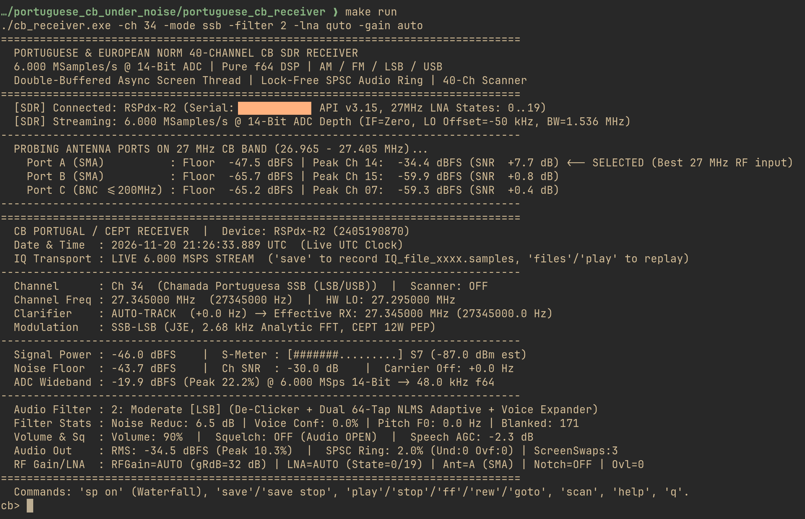
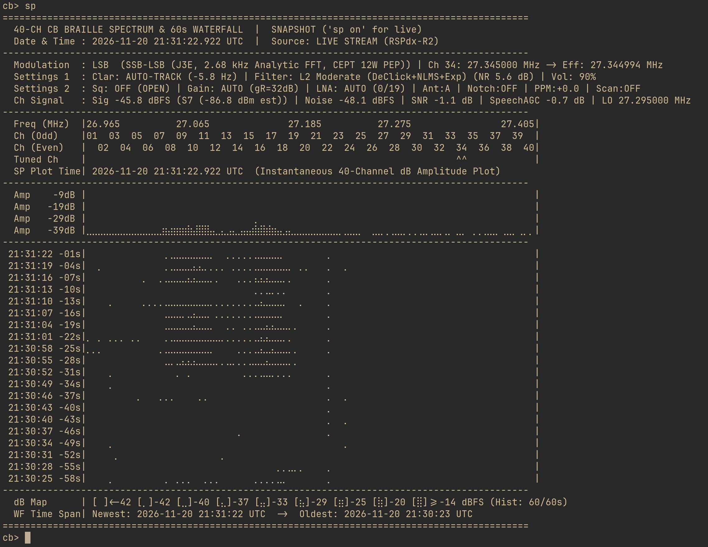

# Portuguese and European CB SDR Receiver in Odin with SDRplay 14 Bit
Listenning to the Citizens Band radio waves in AM, FM and SSB on 40 channels ...

## Description
A command-line Citizens Band (**Banda do Cidadão — 27 MHz / 11m**) Software-Defined Radio receiver written **in the Odin programming language**, using the workspace's `SDRplay_API_Odin_bindings` (SDRplay API v3.15) and Odin's built-in `vendor:miniaudio` audio library.

Implements the complete **Portuguese (ANACOM QNAF)** and **European Harmonised (CEPT ECC/DEC/(11)03 / ETSI EN 300 433)** 40-channel CB allocation (`26.965 MHz` – `27.405 MHz`) for **AM**, **FM**, and **SSB** (**LSB** and **USB**), featuring:
- **6.0 MSamples/s @ Maximum 14-Bit SDRplay ADC Depth**
- **100% 64-Bit Floating-Point (`f64` / `complex128`)** DSP & custom from-scratch **`f64` Radix-2 FFT**
- **40-Channel × 3-Band (`AM`, `FM`, `SSB` [`LSB` & `USB`]) Wideband Auto-Scanner & Exact RF Frequency Verifier**
- **Real-Time 40-Channel Braille Spectrum & 60-Second Waterfall (`sp [on|off]` / `spetrum [on|off]`)** — displays exact UTC Date & Time stamps, complete receiver settings, current modulation, upper dB amplitude plot, and lower 60s waterfall
- **Raw `6.0 MSPS` 14-Bit Full-Spectrum I/Q Disk Recorder & Seekable Player (`IQ_file_0000.samples`, `IQ_file_0001.samples`, ...)** — lock-free SPSC background disk writer (`24 MB/s`, zero drops) + O(1) seekable playback (`save`, `save stop`, `files`, `read`, `play`, `stop`, `forward`/`ff`, `backward`/`rew`, `goto <ts>`, `live`) with recorded Date & Time stamps across `sp`, waterfall, and `s` statistics
- **Closed-Loop Auto-Clarifier (`AM` Carrier PLL + `FM` Center DC + `SSB` Suppressed-Carrier Vocal Harmonic Comb)**
- **Adaptive Multi-Mode `f64` Auto-Squelch (`sq auto` / `autosq`)**
- **Closed-Loop Auto LNA & Auto RF Gain** + **Multi-Port Antenna Auto-Prober (`Port A / B / C BNC`)**
- **Dedicated-Thread Ping-Pong Double-Buffered Screen Engine (`2 × 256 KiB`) & Lock-Free Atomic SPSC Audio Ring Buffer (`262,144` frames)** — zero screen tearing, zero blocking terminal I/O on DSP/audio threads, zero ring-buffer underruns or overflows
- **4 Progressive Band-Specific Indoor House & Communications Noise Filters** (with Level 3 recovering human voice down to **`-15 dB`** and Level 4 down to **`-20` to `-30 dB` below the noise floor**, plus exact **`0.0` zero-volume digital silence** during non-speech intervals and multi-tone heterodyne/whistle ANF when `notch on` is enabled)

## Printscreen





## Build & Self-Test Verification

```bash
# Build optimized binary (cb_receiver.exe)
make

# Run 16-stage f64 FFT, AM/FM THD & De-Emphasis, 40-Ch Scanner, Braille Waterfall, IQ Save/Play/Seek, -30 dB SSB & Ch 25 / Ch 34 LSB Sub-Noise Speech Intelligibility test suite
make test
```

---

## Quick Start on Real SDRplay Hardware

```bash
# 1. Start receiver and immediately auto-probe antenna ports (A/B/C BNC) + scan all 40 CB channels across AM, FM & SSB:
./cb_receiver.exe -scan

# 2. Sweep all 40 CB channels once on startup to verify exact RF frequencies (Hz) and band noise floor:
./cb_receiver.exe -freqcheck

# 3. Nighttime weak-signal DX on Channel 34 (27.345 MHz LSB) or Channel 25 (27.245 MHz LSB) with sub-noise Filter 3 (-15 dB) / Filter 4 (-20..-30 dB), Notch ON & Auto-Clarifier:
./cb_receiver.exe -ch 34 -mode lsb -filter 3 -notch on -clarauto
./cb_receiver.exe -ch 34 -mode lsb -filter 4 -notch on -clarauto
./cb_receiver.exe -ch 25 -mode lsb -filter 4 -clarauto

# 4. Tune directly to Channel 27 (27.275 MHz USB) or Channel 19 (27.185 MHz AM):
./cb_receiver.exe -ch 27 -mode usb -filter 4
./cb_receiver.exe 19

# 5. Run live hardware RF spectrum & 4-filter deep benchmark on Channel 25 LSB (27.245 MHz) or Channel 27 (27.275 MHz):
./cb_receiver.exe -diag 25 -mode lsb
./cb_receiver.exe -diag 27

# 6. Test without hardware using the 6.0 MSPS 14-Bit Multi-Channel CB Spectrum Simulator:
./cb_receiver.exe -sim -scan

# 7. Start saving raw 6.0 MSPS spectrum immediately, or replay a saved IQ_file_xxxx.samples file:
./cb_receiver.exe -save
./cb_receiver.exe -play IQ_file_0000.samples
```

---

## Plain Text-Mode Runtime Commands

Type any command at the `cb> ` prompt and press **Enter**. Use **Up / Down Arrows** to navigate previous commands, **Left / Right / Home / End** + **Backspace / Delete** to edit or erase in-place, and **Enter** to re-run (implemented using simple `stty` terminal commands and `\r` / `\b` — zero OS-specific termios APIs):

| Command | Description |
|---|---|
| `Up / Down Arrows` | Navigate backward/forward through recent commands (preserves unsubmitted draft) |
| `Left / Right / Backspace / Delete` | Move cursor, erase, insert or alter recalled commands and press **Enter** to re-run |
| `history` / `hist` | Print numbered list of recent commands |
| `scan` (or `scan all`) | Start continuous **40-Channel Auto-Scanner** across all 3 bands (**AM, FM, LSB & USB**) |
| `scan am` \| `scan fm` \| `scan ssb` \| `scan lsb` \| `scan usb` | Scan all 40 channels in a specific band/modulation |
| `scan once` | Sweep all 40 channels once, print spectrum & frequency report, and lock strongest voice |
| `scan next` / `scan stop` | Skip current locked channel / Stop scanner and hold current channel |
| `scan thresh <dB>` | Set scanner SNR threshold in dB (default `4.5`, e.g. `scan thresh 3.5` for weak DX) |
| `sp [on\|off]` / `spetrum [on\|off]` | Show **40-Channel Braille Spectrum (upper) & 60-Second Waterfall (lower)** with exact Date & Time stamps, all current settings & modulation (`sp` snapshot, `sp on` live, `sp off` stop) |
| `save` / `save stop` (or `endsave`) | Start / end saving all raw `6.0 MSPS` 14-Bit I/Q spectrum to auto-incrementing `IQ_file_0000.samples`, `IQ_file_0001.samples`, ... |
| `files` (or `iqfiles`) | List all saved `IQ_file_xxxx.samples` files with Size, Duration, Ch/Mode & Recorded UTC Date/Time |
| `read [id\|file]` / `play [id\|file]` | Load paused (`read 0000`) or play/resume (`play 0000` or `play`) any saved `IQ_file_xxxx.samples` across all 40 CB channels & modes |
| `stop` / `pause` / `live` | Stop/pause IQ playback (or stop scanner) / Close IQ file and return to LIVE SDR stream |
| `forward [s]` / `ff [s]` \| `backward [s]` / `rew [s]` | Jump forward or backward in the loaded IQ file (default `5 s`; also `go forward 10`, `go backward 5`) |
| `goto <ts>` / `seek <ts>` / `go to <ts>` | Jump to any timestamp (`12.5`, `01:30`, recorded `HH:MM:SS`, or `"YYYY-MM-DD HH:MM:SS"`) |
| `freqcheck` (or `sp table`) | Sweep all 40 channels & print **exact measured RF peak frequencies in MHz & Hz** |
| `diag [1..40]` | Capture live I/Q on channel & benchmark RF peaks + all 4 audio noise filters (`AM/FM/LSB/USB`) |
| `ant auto` (or `antscan`) | Probe Antenna Ports **A, B, and C (BNC)** on RSPdx/RSPdx-R2/RSP2 and select live antenna |
| `ant <a\|b\|c>` | Manually select Antenna Port A, B, or C |
| `gain auto` / `gain <20..59>` | Enable closed-loop **Auto RF Gain** (`gain auto`) or manual IF `gRdB` (`20..59`) |
| `lna auto` / `lna <0..19>` | Enable closed-loop **Auto LNA** (`lna auto`) or manual 27 MHz `LNAstate` (`0` = max sensitivity) |
| `<1..40>` or `ch <1..40>` | Tune CB channel `1` to `40` (e.g. `19` or `ch 38`) |
| `n` / `p` | Step to next (`+1`) or previous (`-1`) CB channel |
| `am` \| `fm` \| `lsb` \| `usb` | Switch modulation (`mode am`, `mode fm`, `mode lsb`, `mode usb`) |
| `filter <0..4>` (or `f <0..4>`) | Select audio noise filter (`0=Off`, `1=Simple`, `2=Moderate`, `3=Advanced`, `4=Ultra Voice -30dB`) |
| `vol <0..200 \| +N \| -N>` | Set or nudge audio volume % (`vol 90`, `vol +10`, `vol -10`) |
| `sq <auto \| -135..0 \| off \| on>` | Enable **Adaptive Auto-Squelch** (`sq auto` / `autosq` / `squesh auto`), manual `dBFS`, or `sq off` |
| `clar auto` / `clar off` | Enable or disable **Auto-Clarifier** (`autoclar on\|off`; enabled by default across AM/FM/LSB/USB) |
| `clar <-5000..+5000>` / `clar reset` | Set manual clarifier offset in `Hz` (`clar -60`, `clar step +10`) or reset offset (`clar reset`) |
| `notch <on\|off>` | Toggle SDRplay hardware FM/DAB broadcast notch filter (default `off`) |
| `ppm <value>` | Set crystal frequency correction in PPM |
| `mon <0..60>` | Print compact single-line telemetry every `N` seconds (`mon 0` stops) |
| `channels` | Print the complete 40-channel ANACOM / CEPT CB frequency table |
| `s` (or empty **Enter**) | Refresh and print full Channel, Frequency, Signal dB, S-Meter, Gain/LNA & Filter report |
| `help` / `?` | Show plain-text command summary |
| `q` / `quit` | Stop streaming and exit cleanly |

---

## Project File Layout (19 Total Files)

- `main.odin` — CLI argument parser (`-save`, `-play`, `-scan`, `-sp`, etc.), `screen_init` / `screen_shutdown` lifecycle, startup antenna prober, and engine orchestration
- `cb_channels.odin` — 40-channel ANACOM/CEPT CB frequency table, modes, filter labels, and S-meter math
- `fft_f64.odin` — Custom `f64` Radix-2 FFT/IFFT, window functions, FIR designer, `2048-pt` Overlap-Save channel filter (`11.2 kHz` FM Carson BW, `8.0 kHz` AM, `[-2800..-125 Hz]` / `[+125..+2800 Hz]` analytic SSB with `138.5 dB` opposite-sideband rejection), and zero-delay `48 kHz` baseband I/Q impulse blanker
- `decimator_f64.odin` — `6.0 MSPS` -> `48 kHz` arbitrary-LO `f64` NCO mixer, 2-stage polyphase FIR decimator, and step-adaptive `240 kHz` Huber-Rayleigh wideband I/Q impulse blanker
- `demodulators_f64.odin` — Zero-lag wideband `f64` Synchronous AM PLL (`0.001%` THD), Linear Conjugate-Product + Threshold-Extension FM Demodulator with `530.5 us` (`300 Hz`) CEPT de-emphasis (`0.009%` THD), Analytic LSB/USB with noise-anchored IF leveler, sub-noise-floor Auto-Clarifier, True SSB Syllabic Hang-AGC & Auto-Squelch
- `scanner_f64.odin` — Wideband `6.0 MSPS -> 1.200 MSPS` `4096-pt` `f64` 40-Channel × 3-Band Auto-Scanner, Date/Time-stamped 40-Channel Braille Spectrum & 60s Waterfall with full settings & modulation header, Parabolic RF Frequency Calibrator & Antenna Prober
- `iq_recorder_player.odin` — Asynchronous lock-free SPSC `6.0 MSPS` 14-Bit raw spectrum recorder (`IQ_file_0000.samples`, `IQ_file_0001.samples`, ...) & crystal-paced O(1)-seekable I/Q file player with nanosecond UTC Date/Time stamping
- `filters_simple_moderate.odin` — Band-specific `f64` Audio Noise Filters Level 1 & Level 2 (with SSB-harmonic-preserving `50..250 Hz` European mains hum comb)
- `filters_spectral_deep.odin` — Band-specific `f64` Audio Noise Filters Level 3 (`2048-pt` Harmonic-Guided Cohen OM-LSA + Martin MCRA + Parabolic Birdie Canceller) & Level 4 (`4096-pt` Dual-Timescale SHS Pitch/Mistune Comb + Cepstrum + Broadband Consonant Burst Recovery + Pause-Gated Post-Echo Suppressor for `-20` to `-30 dB` SSB)
- `receiver_state.odin` — `Receiver_Context`, `262,144`-sample Lock-Free Atomic SPSC `f64` audio ring buffer, DSP block router, IQ recorder/player integration, and timestamped telemetry snapshot
- `sdr_engine.odin` — SDRplay API v3.15 `6.0 MSPS` 14-bit hardware controller (`.AGC_5HZ` `-18 dBFS` slow IF loop + `LNA=0` weak-signal Auto-LNA & Auto-RF-Gain supervisor) & crystal-paced multi-channel RF simulator
- `audio_output.odin` — Odin `vendor:miniaudio` `48 kHz` lock-free SPSC playback engine with `128 ms` pre-fill cushion & elastic drift governor
- `cli_interface.odin` — Plain text-mode command loop, `stty` Up/Down arrow history editor, IQ transport keywords (`save`, `read`, `play`, `stop`, `ff`, `rew`, `goto`, `live`), and atomic `Screen_Frame` status / table views
- `screen_printer.odin` — Dedicated background OS thread + `2 × 256 KiB` Front/Back ping-pong double-buffered screen output engine
- `dsp_selftest.odin` — Deterministic 15-stage `f64` DSP, FFT, AM/FM THD & De-Emphasis, RF Frequency, 40-Ch Scanner, Auto-Clarifier, Braille Waterfall, CLI Editor, Double-Buffered Screen, Lock-Free SPSC Ring, `IQ_file_xxxx.samples` Save/Play/Seek, `-20/-25/-30 dB` SSB voice recovery & Ch 25 LSB `-10 dB` DX speech intelligibility suite
- `Makefile` — One-command build, test, hardware run, and simulator targets
- `README.md` — Quick-start summary
- `how_it_all_works.md` — Complete plain-text architecture, math, pseudo-code, API reference, and usage manual

## License
MIT Open Source License

## Have fun
Best regards, <br>
Joao Carvalho
